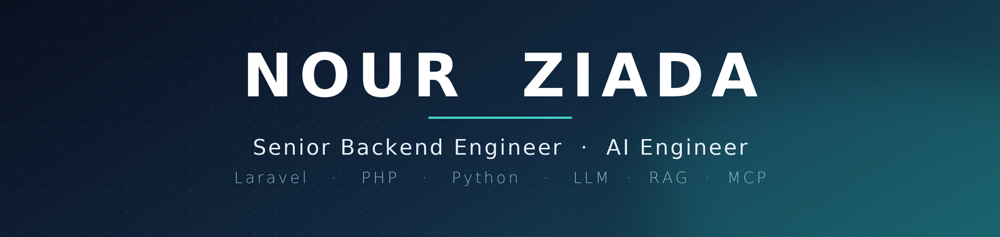

 

  

I build production systems — **REST APIs**, **multi-tenant SaaS**, and **AI agents** that carry out real tasks.

Backend architecture in Laravel and PHP · AI engineering in Python with LLM APIs, RAG and MCP.

 

### Stack

  

### Featured

#### [job-match-advisor](https://github.com/nourziada/job-match-advisor)

An AI agent that reads a job posting, compares it against a CV using RAG, and returns a structured verdict with the criteria behind every decision.

